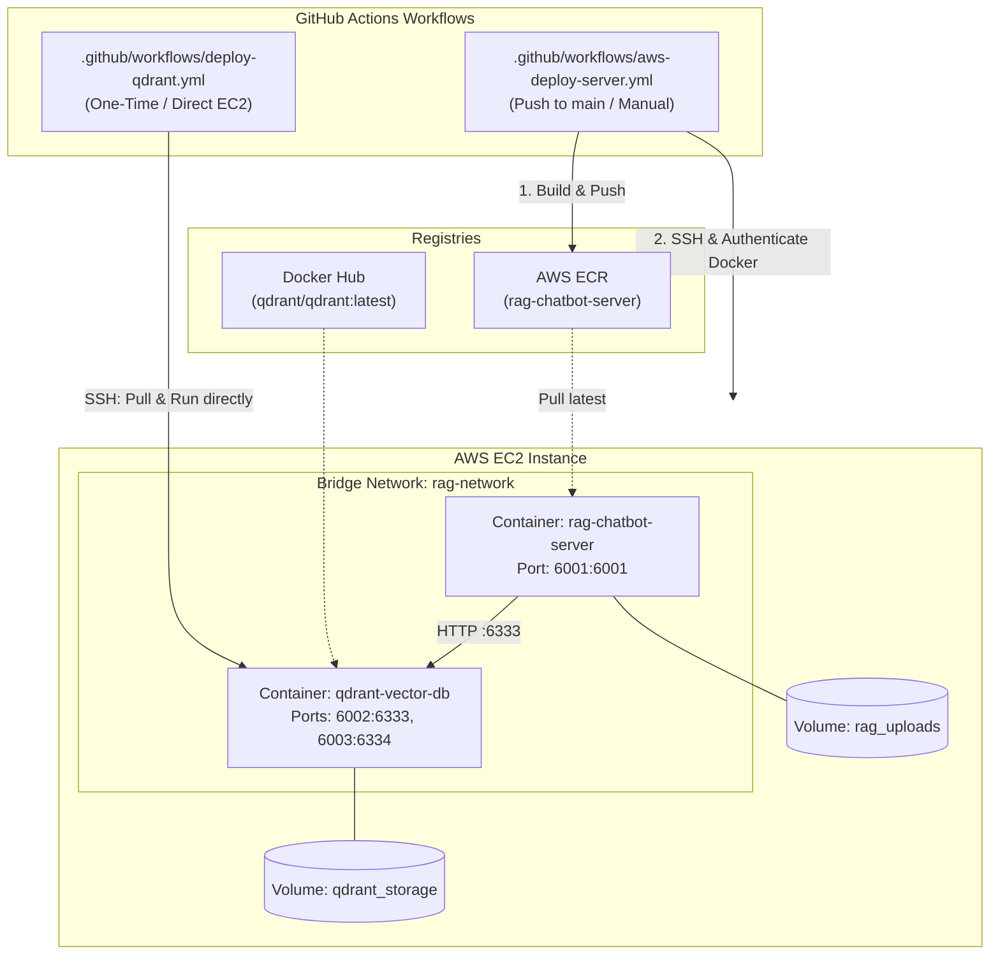

# AWS Deployment Pipelines: Qdrant Vector DB & Node.js Server

This deployment architecture is modeled after the `Realtime-Chat-App` deployment pipeline:
1. **`deploy-qdrant.yml`**: Directly deploys the official **Qdrant Vector Database** (`qdrant/qdrant:latest`) on AWS EC2 inside a shared Docker network (`rag-network`) with persistent storage volume (`qdrant_storage`).
2. **`aws-deploy-server.yml`**: Builds the **Node.js Express Server**, pushes the image to **AWS Elastic Container Registry (ECR)**, fetches an authenticated ECR token on EC2, and runs the server container on AWS EC2 linked to the Qdrant database over `rag-network`.

---

## 🏗 Architecture Overview



---

## 📁 Workflows Breakdown

### 1. `.github/workflows/deploy-qdrant.yml`
- **Purpose**: Deploys or restarts the Qdrant vector database container directly on EC2 from Docker Hub (similar to `deploy-mongo.yml` in the socket chat project).
- **Trigger**: Manual trigger via GitHub Actions (`workflow_dispatch`).
- **Actions executed on EC2**:
  - Creates the shared Docker network: `docker network create rag-network || true`.
  - Pulls `qdrant/qdrant:latest`.
  - Removes any old `qdrant-vector-db` container.
  - Runs container with persistent volume:
    ```bash
    docker run -d --name qdrant-vector-db --network rag-network \
      --restart always \
      -v qdrant_storage:/qdrant/storage \
      -p 6002:6333 \
      -p 6003:6334 \
      -e QDRANT__SERVICE__HTTP_PORT=6333 \
      qdrant/qdrant:latest
    ```

### 2. `.github/workflows/aws-deploy-server.yml`
- **Purpose**: Builds and deploys the Node.js server to AWS ECR and EC2 (similar to `aws-deploy-server.yml` in the socket chat project).
- **Trigger**: Push to `main` branch or manual trigger (`workflow_dispatch`).
- **Job 1 (`build-and-push`)**:
  - Configures AWS credentials (`aws-actions/configure-aws-credentials@v4`).
  - Logs into Amazon ECR (`aws-actions/amazon-ecr-login@v2`).
  - Generates `.env` file for production.
  - Builds and pushes the Node.js server image with tags `latest` and `${{ github.sha }}`.
- **Job 2 (`deploy`)**:
  - Obtains ECR login token securely using `aws ecr get-login-password` and masks it.
  - Connects to EC2 using `appleboy/ssh-action@v1.0.3`.
  - Ensures `rag-network` and `qdrant-vector-db` are running.
  - Authenticates Docker with AWS ECR on EC2:
    ```bash
    echo "$ECR_PASSWORD" | docker login --username AWS --password-stdin $REGISTRY
    ```
  - Pulls the latest image from ECR:
    ```bash
    docker pull $REGISTRY/$IMAGE_NAME:latest
    ```
  - Restarts the container with persistent uploads volume and environment variables:
    ```bash
    docker rm -f rag-chatbot-server || true
    docker run -d --name rag-chatbot-server --network rag-network \
      --restart always \
      -v rag_uploads:/app/uploads \
      -p 6001:6001 \
      -e PORT=6001 \
      -e NODE_ENV=production \
      -e OPENAI_API_KEY="$OPENAI_API_KEY" \
      -e OPENAI_CHAT_MODEL="$OPENAI_CHAT_MODEL" \
      -e OPENAI_EMBEDDING_MODEL="$OPENAI_EMBEDDING_MODEL" \
      -e QDRANT_URL="http://qdrant-vector-db:6333" \
      -e QDRANT_COLLECTION_NAME="$QDRANT_COLLECTION_NAME" \
      -e UPLOAD_DIR="/app/uploads" \
      $REGISTRY/$IMAGE_NAME:latest
    ```

---

## 🔑 GitHub Secrets and Variables Setup

In GitHub (**Settings > Secrets and variables > Actions**):

### Repository Secrets (`secrets.*`)
| Secret Name | Required | Description |
|---|---|---|
| `AWS_ACCESS_KEY_ID` | **Yes** | AWS IAM Access Key ID |
| `AWS_SECRET_ACCESS_KEY` | **Yes** | AWS IAM Secret Access Key |
| `EC2_HOST` | **Yes** | Public IP or Public DNS of your EC2 instance |
| `EC2_USERNAME` | **Yes** | SSH Username (e.g., `ubuntu` or `ec2-user`) |
| `EC2_SSH_KEY` | **Yes** | Private SSH Key contents (`.pem`) |
| `OPENAI_API_KEY` | **Yes** | OpenAI API Key (`sk-...`) |

### Repository Variables (`vars.*`) (Optional / Configurable)
| Variable Name | Default if Omitted | Description |
|---|---|---|
| `AWS_REGION` | `us-east-1` | AWS Region of ECR and EC2 |
| `ECR_REPOSITORY_SERVER` | `rag-chatbot-server` | Name of AWS ECR Repository |
| `OPENAI_CHAT_MODEL` | `gpt-4o-mini` | Chat model name |
| `OPENAI_EMBEDDING_MODEL` | `text-embedding-3-small` | Embeddings model |
| `QDRANT_COLLECTION_NAME` | `rag_documents` | Vector DB collection name |

---

## 🚀 Step-by-Step Initial Setup

### 1. Create AWS ECR Repository
```bash
aws ecr create-repository \
  --repository-name rag-chatbot-server \
  --region us-east-1 \
  --image-scanning-configuration scanOnPush=true
```

### 2. Configure EC2 Security Group
Open these inbound ports on your EC2 instance security group:
- **Port 22 (SSH)**: Accessible from your IP or GitHub runner.
- **Port 6001 (Node.js App)**: Accessible from `0.0.0.0/0` (Web UI).
- **Port 6002 (Qdrant Dashboard & REST API)**: Accessible from your IP or `0.0.0.0/0`.

### 3. Setup Docker on EC2
Connect to EC2:
```bash
ssh -i your-key.pem ubuntu@<EC2-HOST>
```
Install Docker on EC2:
```bash
sudo apt-get update && sudo apt-get install -y docker.io
sudo usermod -aG docker $USER
newgrp docker
```

### 4. Deploy Qdrant
In GitHub, go to **Actions** -> **Deploy Qdrant (One-Time)** -> click **Run workflow**.

### 5. Deploy Server
Commit and push to `main` (or run **Build and Deploy Server to AWS ECR and EC2** manually in **Actions**).

---

## 🔍 Verification & Health Check

After deployment:
```bash
# Verify running containers
docker ps

# Check Node.js API health
curl http://<EC2-HOST>:6001/api/health

# Check Qdrant readiness
curl http://<EC2-HOST>:6002/readyz
```
- Open `http://<EC2-HOST>:6001` in your browser to access the RAG Chatbot UI.
- Open `http://<EC2-HOST>:6002/dashboard` to inspect the Qdrant Web Dashboard.
