# RAG-Based AI Chatbot 📄🤖

An end-to-end, production-ready web application designed for ingesting, indexing, and conversing with PDF documents using Retrieval-Augmented Generation (RAG). Built with a modular **TypeScript + Express** backend, **LangChain**, **Qdrant Vector Database**, and **OpenAI**, paired with a responsive, polished **Tailwind CSS + Vanilla ES Modules** frontend supporting native Dark/Light mode and real-time streaming answers.

---

## 📑 Table of Contents

- [Overview](#-overview)
- [Key Features](#-key-features)
- [Architecture & Tech Stack](#-architecture--tech-stack)
- [RAG Workflow Pipeline](#-rag-workflow-pipeline)
- [Project Structure](#-project-structure)
- [API Endpoints](#-api-endpoints)
- [Getting Started](#-getting-started)
  - [Prerequisites](#prerequisites)
  - [Installation](#installation)
  - [Environment Configuration](#environment-configuration)
  - [Starting Qdrant Vector Database](#-starting-qdrant-vector-database-docker)
  - [Running the Application](#running-the-application)
- [Usage Guide](#-usage-guide)
- [Implementation Status & Roadmap](#-implementation-status--roadmap)
- [Contributing](#-contributing)
- [License](#-license)

---

## 🌟 Overview

The **RAG-Based AI Chatbot** enables users to upload PDF documents (such as financial reports, research papers, agreements, or technical manuals) and ask questions in natural language. The system automatically extracts text, segments it into semantic chunks, generates high-dimensional vector embeddings, indexes them into a localized Qdrant vector database, and uses semantic retrieval to ground OpenAI responses with precise source context.

Answers are streamed in real time to the browser via **Server-Sent Events (SSE)** with a typewriter effect, accompanied by interactive source attribution and an embedded PDF preview modal.

---

## ✨ Key Features

- **Document Ingestion & Chunking**:
  - Drag-and-drop or browse file picker with single-click upload.
  - Supports PDF files up to **25 MB** with strict MIME-type and extension validation.
  - Automated text extraction using `pdf-parse`.
  - Semantic chunking via LangChain's `RecursiveCharacterTextSplitter` (1,000 characters per chunk, 200 character overlap).
- **Vector Embeddings & Database**:
  - Dense vector embeddings generated via OpenAI's `text-embedding-3-small`.
  - High-performance vector indexing and cosine similarity search using **Qdrant** running in Docker.
  - Automatic collection creation (`rag_documents`) and metadata preservation (source name, filename).
- **Contextual Retrieval & Generation**:
  - Semantic query search retrieving top-K relevant chunks with similarity scoring.
  - Formatted multi-source context construction for LLM grounding.
  - LLM response generation via OpenAI `gpt-4o-mini` (or configurable model).
- **Real-Time Streaming Responses (SSE)**:
  - Token-by-token streaming over **Server-Sent Events** (`text/event-stream`).
  - Graceful connection termination with `AbortController` and `[DONE]` stream markers.
  - Non-streaming JSON fallback support (`stream: false`).
- **Interactive Document Viewer**:
  - Embedded in-app PDF preview modal using native browser rendering.
  - Multi-tab document switcher directly inside the modal preview.
  - Quick actions to open documents in a dedicated browser tab.
- **Modern UI & Aesthetic**:
  - Clean interface styled with Tailwind CSS and typography (*Instrument Serif* + *Plus Jakarta Sans*).
  - Smooth **Dark and Light Theme** toggle with persistence in `localStorage`.
  - Floating toast notification system for instant feedback.

---

## 🛠 Architecture & Tech Stack

```mermaid
flowchart TD
    subgraph Ingestion["1. Document Ingestion Pipeline"]
        A[User Uploads PDF] --> B[Multer Middleware]
        B --> C[PDF Text Extraction\npdf-parse]
        C --> D[Text Splitter\nRecursiveCharacterTextSplitter]
        D --> E[OpenAI Embeddings\ntext-embedding-3-small]
        E --> F[(Qdrant Vector DB\nrag_documents)]
    end

    subgraph RetrievalGeneration["2. Retrieval & Generation Pipeline"]
        G[User Query] --> H[Generate Query Embedding]
        H --> I[Qdrant Similarity Search\nTop-K Relevant Chunks]
        I --> J[Context Assembler & System Prompt]
        J --> K[OpenAI Chat Completion\ngpt-4o-mini]
        K -->|SSE Stream| L[Chat UI / Typewriter Display]
    end
```



### Backend
- **Runtime**: [Node.js](https://nodejs.org/) (v18+)
- **Language**: [TypeScript](https://www.typescriptlang.org/)
- **Server Framework**: [Express.js](https://expressjs.com/) (v4.21+)
- **RAG & Vector Framework**: 
  - `@langchain/core` & `@langchain/openai`
  - `@langchain/qdrant` & `@qdrant/js-client-rest`
  - `@langchain/textsplitters`
- **LLM Provider**: [OpenAI API](https://platform.openai.com/) (`openai` SDK v7+)
- **Document Processing**: `pdf-parse`, `multer`
- **Utilities**: `dotenv`, `cors`, `tsx` (TypeScript execution and hot reload)

### Database
- **Vector Engine**: [Qdrant](https://qdrant.tech/) (`qdrant/qdrant:latest` running via Docker Compose)
  - REST API & Web Dashboard: Port `6002` (mapped from `6333`)
  - gRPC API: Port `6003` (mapped from `6334`)

### Frontend
- **Styling**: [Tailwind CSS](https://tailwindcss.com/)
- **Architecture**: Vanilla JavaScript with ES Modules (`chat.js`, `upload.js`, `theme.js`, `toast.js`)
- **Real-Time Protocol**: Fetch API with `ReadableStream` decoding Server-Sent Events (`text/event-stream`)
- **Typography**: Google Fonts (*Plus Jakarta Sans*, *Instrument Serif*)

---

## 📁 Project Structure

```plaintext
RAG-Based AI Chatbot/
├── .env                              # Local environment configuration (API keys, ports)
├── .env.example                      # Template for environment configuration
├── .gitignore                        # Git exclusion rules
├── docker-compose.yml                # Qdrant vector database container configuration
├── package.json                      # Project metadata, dependencies, scripts
├── package-lock.json                 # Dependency lockfile
├── tsconfig.json                     # TypeScript compiler configuration
├── server.ts                         # Express server bootstrap & middleware entry
├── uploads/                          # Local disk storage for uploaded PDFs
├── dist/                             # Compiled JavaScript output (generated on build)
├── public/                           # Frontend static assets
│   ├── index.html                    # Document upload landing page
│   ├── chat.html                     # RAG Chat & document viewer interface
│   ├── app.js                        # General frontend entry
│   └── js/
│       ├── chat.js                   # Chat messaging, SSE stream decoding, PDF modal
│       ├── theme.js                  # Light / Dark theme toggler & localStorage sync
│       ├── toast.js                  # Toast notification utility
│       └── upload.js                 # Drag-and-drop validation, upload handler
└── src/                              # Backend source code
    ├── config/
    │   └── index.ts                  # Centralized typed configuration from environment
    ├── routes/
    │   ├── index.ts                  # Main API router (mounts /api & view routes)
    │   ├── chat.routes.ts            # POST /api/chat (SSE streaming & JSON fallback)
    │   ├── upload.routes.ts          # POST /api/upload & GET /api/files
    │   └── view.routes.ts            # GET / & GET /chat page routes
    └── services/
        ├── chat.service.ts           # Chat orchestration & source resolution
        ├── generation.service.ts     # OpenAI completion & streaming generators
        ├── ingest.service.ts         # Ingestion pipeline (parse -> chunk -> embed -> store)
        └── retrieval.service.ts      # Semantic vector search & context builder
```

---

## 📡 API Endpoints

### 1. Health Check
- **Route**: `GET /api/health`
- **Description**: Verifies that the server is operational.
- **Response (200)**:
  ```json
  {
    "status": "ok",
    "message": "Server is running",
    "timestamp": "2026-11-10T21:10:00.000Z"
  }
  ```

### 2. Upload & Ingest PDF Document
- **Route**: `POST /api/upload`
- **Content-Type**: `multipart/form-data`
- **Form Field**: `pdfs` (single PDF file, max 25 MB)
- **Description**: Receives the PDF, extracts text, generates chunks, calculates vector embeddings, and indexes them into Qdrant.
- **Success Response (200)**:
  ```json
  {
    "success": true,
    "message": "PDF ingested: 12 chunks, indexed in Qdrant.",
    "file": {
      "fileName": "1731250000000-report.pdf",
      "originalName": "report.pdf",
      "url": "/uploads/1731250000000-report.pdf",
      "size": 1048576,
      "chunksInfo": { "totalChunks": 12 },
      "embeddingsInfo": { "totalEmbeddings": 12 }
    },
    "files": [ ... ],
    "totalChunks": 12,
    "totalEmbeddings": 12,
    "storedInQdrant": true
  }
  ```

### 3. List Uploaded Files
- **Route**: `GET /api/files`
- **Description**: Returns all uploaded PDF files stored on the server.
- **Success Response (200)**:
  ```json
  {
    "success": true,
    "files": [
      {
        "fileName": "1731250000000-report.pdf",
        "originalName": "report.pdf",
        "url": "/uploads/1731250000000-report.pdf"
      }
    ]
  }
  ```

### 4. Query & Chat (RAG)
- **Route**: `POST /api/chat`
- **Content-Type**: `application/json`
- **Body**:
  ```json
  {
    "message": "Summarize the key findings from the executive summary.",
    "files": [
      {
        "fileName": "1731250000000-report.pdf",
        "originalName": "report.pdf"
      }
    ],
    "stream": true
  }
  ```

#### Streaming Mode (`stream: true`, default)
- **Content-Type**: `text/event-stream`
- **Response Format**:
  ```text
  data: "Based"

  data: " on"

  data: " the"

  data: " document..."

  data: [DONE]
  ```

#### Non-Streaming Mode (`stream: false`)
- **Content-Type**: `application/json`
- **Response Format**:
  ```json
  {
    "success": true,
    "reply": "Based on the provided document, the executive summary outlines...",
    "sources": ["report.pdf"],
    "context": "[Source 1: report.pdf]\n..."
  }
  ```

---

## 🚀 Getting Started

### Prerequisites

Ensure you have the following installed on your machine:
- **Node.js**: `v18.0.0` or higher
- **npm**: `v9.0.0` or higher
- **Docker & Docker Compose**: For running the Qdrant vector database container
- **OpenAI API Key**: Required for embeddings (`text-embedding-3-small`) and completions (`gpt-4o-mini`)

Check versions:
```bash
node -v
npm -v
docker --version
```

### Installation

1. **Clone or navigate to the repository directory**:
   ```bash
   cd "RAG-Based AI Chatbot"
   ```

2. **Install project dependencies**:
   ```bash
   npm install
   ```

---

### Environment Configuration

1. Copy the example environment file:
   ```bash
   cp .env.example .env
   ```
   *(On Windows PowerShell: `Copy-Item .env.example .env`)*

2. Open `.env` and fill in your settings:
   ```ini
   # Server Configuration
   PORT=6001
   NODE_ENV=development
   # UPLOAD_DIR=uploads

   # OpenAI Configuration
   OPENAI_API_KEY=your_openai_api_key_here
   OPENAI_CHAT_MODEL=gpt-4o-mini
   OPENAI_EMBEDDING_MODEL=text-embedding-3-small

   # Qdrant Vector Database Configuration
   QDRANT_URL=http://localhost:6002
   QDRANT_PORT=6002
   QDRANT_COLLECTION_NAME=rag_documents
   QDRANT_API_KEY=
   ```

| Variable | Description | Default |
|:---|:---|:---|
| `PORT` | HTTP port the Express server listens on | `6001` (fallback `3000`) |
| `NODE_ENV` | Application environment (`development` / `production`) | `development` |
| `UPLOAD_DIR` | Directory where uploaded PDFs are stored | `uploads` |
| `OPENAI_API_KEY` | OpenAI secret API key | *Required* |
| `OPENAI_CHAT_MODEL` | OpenAI chat completion model | `gpt-4o-mini` |
| `OPENAI_EMBEDDING_MODEL` | OpenAI vector embedding model | `text-embedding-3-small` |
| `QDRANT_URL` | Base URL of the Qdrant vector database service | `http://localhost:6002` |
| `QDRANT_PORT` | Host port mapped to Qdrant REST service | `6002` |
| `QDRANT_COLLECTION_NAME`| Name of the vector collection in Qdrant | `rag_documents` |
| `QDRANT_API_KEY` | Optional API key for protected Qdrant instances | *(empty / none)* |

---

### 🐳 Starting Qdrant Vector Database (Docker)

The application requires Qdrant running to store and query vector embeddings. Use the bundled npm scripts:

```bash
# Start Qdrant container in the background
npm run qdrant:start

# Verify that the container is running
npm run qdrant:status

# View live Qdrant container logs
npm run qdrant:logs

# Stop Qdrant container
npm run qdrant:stop

# Restart Qdrant container
npm run qdrant:restart
```

- **Qdrant REST API & Web Dashboard**: [http://localhost:6002/dashboard](http://localhost:6002/dashboard)
- **Data Persistence**: Uses a named Docker volume (`qdrant_storage`) so collections persist across container restarts.

---

### Running the Application

#### Development Mode (with Live Reload)
Runs the server with instant hot-reloading when modifying TypeScript files:
```bash
npm run dev
```
The server will start at **`http://localhost:6001`** (or the port defined in your `.env`).

#### Production Build & Run
To compile TypeScript into optimized JavaScript in `dist/` and run in production:
```bash
# 1. Compile TypeScript
npm run build

# 2. Start production server
npm start
```

---

## 📖 Usage Guide

1. **Start the Services**:
   - Ensure Qdrant is running (`npm run qdrant:start`).
   - Start the server (`npm run dev`).
2. **Upload a PDF Document**:
   - Open [http://localhost:6001](http://localhost:6001) in your browser.
   - Drag and drop a PDF file or click the upload area to browse.
   - Click **"Continue to Chat"**. The document is parsed, chunked, embedded, and indexed into Qdrant.
3. **Chat & Inspect Sources**:
   - You will be redirected to the chat workspace at `/chat`.
   - Ask questions related to the document content.
   - Answers stream in token-by-token.
   - Click on any document pill in the toolbar to open the **PDF Preview Modal** and review the original file.
4. **Switch Color Theme**:
   - Click the Sun/Moon toggle in the upper-right corner to toggle between Dark and Light modes anytime.

---

## 🧠 Implementation Status & Roadmap

- [x] **Modular Architecture**: Clean separation into `routes/`, `services/`, and `config/`.
- [x] **PDF Text Extraction**: Automated extraction via `pdf-parse`.
- [x] **Recursive Chunking**: LangChain `RecursiveCharacterTextSplitter` (1000 chunk size, 200 overlap).
- [x] **Vector Embeddings**: OpenAI `text-embedding-3-small`.
- [x] **Vector Database**: Dockerized Qdrant with automated collection initialization and point upsert.
- [x] **Similarity Search**: Top-K chunk retrieval with similarity scoring and formatted context generation.
- [x] **LLM Generation**: Grounded question-answering with OpenAI `gpt-4o-mini`.
- [x] **Real-Time Streaming**: Server-Sent Events (SSE) with abort controller support.
- [x] **Interactive PDF Modal**: Multi-tab document preview inside the chat view.
- [ ] **Multi-Document Filtering**: Target similarity search to specific documents selected by the user.
- [ ] **Session & Conversation Memory**: Persist message threads and multi-turn conversational context.
- [ ] **Hybrid Search**: Combine BM25 keyword matching with dense vector similarity.

---

## 🤝 Contributing

Contributions, bug reports, and suggestions are welcome!
1. Fork the Project
2. Create your Feature Branch (`git checkout -b feature/AmazingFeature`)
3. Commit your Changes (`git commit -m 'Add some AmazingFeature'`)
4. Push to the Branch (`git push origin feature/AmazingFeature`)
5. Open a Pull Request

---

## 📄 License

Distributed under the **ISC License**. Feel free to use, modify, and distribute this project.
