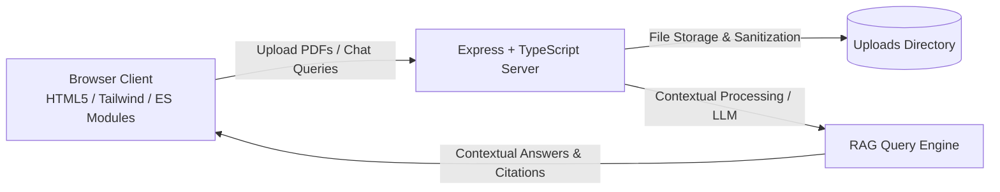

# RAG-Based AI Chatbot 📄🤖

An end-to-end, high-performance web application designed for interacting with and querying PDF documents using Retrieval-Augmented Generation (RAG) workflows. Built with a robust **TypeScript + Express** backend and a responsive, polished **Tailwind CSS + ES Modules** frontend with native Dark/Light mode support.

---

## 📑 Table of Contents

- [Overview](#-overview)
- [Key Features](#-key-features)
- [Architecture & Tech Stack](#-architecture--tech-stack)
- [Project Structure](#-project-structure)
- [API Endpoints](#-api-endpoints)
- [Getting Started](#-getting-started)
  - [Prerequisites](#prerequisites)
  - [Installation](#installation)
  - [Environment Configuration](#environment-configuration)
  - [Running the Application](#running-the-application)
- [Usage Guide](#-usage-guide)
- [RAG Integration & Roadmap](#-rag-integration--roadmap)
- [Contributing](#-contributing)
- [License](#-license)

---

## 🌟 Overview

The **RAG-Based AI Chatbot** empowers users to upload multiple PDF documents (such as financial statements, research papers, reports, or legal agreements) and converse with them naturally. The interface provides instant document visualization via an embedded PDF modal viewer, dynamic source citations, and real-time contextual question answering.

Whether testing localized documents or deploying an enterprise RAG assistant, this codebase provides a solid, modular baseline for ingesting files, handling sessions, and serving AI responses.

---

## ✨ Key Features

- **Document Ingestion & Validation**:
  - Drag-and-drop or browse file picker.
  - Supports up to **3 PDF files** simultaneously with up to **25 MB** per file.
  - Strict MIME-type and extension validation with filename sanitization.
- **Interactive Document Viewer**:
  - Embedded in-app PDF modal preview using native browser rendering.
  - Multi-tab document switcher directly inside the preview modal.
  - Open in a new tab or inspect documents side-by-side.
- **Contextual Chat Workspace**:
  - Clean conversational interface with suggestion prompts and interactive source chips.
  - Typing animations and smooth scrolling.
  - Document context pills dynamically tied to the active uploaded files.
- **Modern UI & Aesthetic**:
  - Crafted with Tailwind CSS and premium typography (*Instrument Serif* + *Plus Jakarta Sans*).
  - Smooth **Dark and Light Theme** toggle with persistence in `localStorage`.
  - Floating toast notifications for feedback and error states.
- **Developer-Friendly Stack**:
  - Strict TypeScript compilation with automated hot-reloading (`tsx watch`).
  - Production-ready compilation to `dist/`.

---

## 🛠 Architecture & Tech Stack



### Backend
- **Runtime**: [Node.js](https://nodejs.org/) (v18+)
- **Language**: [TypeScript](https://www.typescriptlang.org/)
- **Web Framework**: [Express.js](https://expressjs.com/) (v4.21+)
- **File Handling**: [Multer](https://github.com/expressjs/multer) (multipart/form-data upload management)
- **Utilities**: `cors`, `dotenv`, `tsx` (fast TypeScript execution)

### Frontend
- **Styling**: [Tailwind CSS](https://tailwindcss.com/) (CDN utility classes)
- **Architecture**: Vanilla JavaScript with ES Modules (`upload.js`, `chat.js`, `theme.js`, `toast.js`)
- **Typography**: Google Fonts (*Plus Jakarta Sans*, *Instrument Serif*)
- **Icons**: Inline scalable SVG icons

---

## 📁 Project Structure

```plaintext
RAG-Based AI Chatbot/
├── .env.example          # Environment variables template
├── .env                  # Local environment configuration
├── .gitignore            # Git exclusion rules
├── package.json          # Project metadata, dependencies, scripts
├── package-lock.json     # Dependency lockfile
├── tsconfig.json         # TypeScript compiler configuration
├── server.ts             # Express server and API implementation
├── uploads/              # Local disk storage for uploaded PDFs
├── dist/                 # Compiled JavaScript output (generated on build)
└── public/               # Client-side static assets
    ├── index.html        # Upload & landing page
    ├── chat.html         # RAG Chat & document viewer interface
    ├── app.js            # General client utility entry
    └── js/
        ├── upload.js     # Upload validation, drag-and-drop, UI state
        ├── chat.js       # Chat messages, document pills, iframe preview modal
        ├── theme.js      # Dark/Light theme toggler & persistence
        └── toast.js      # Toast notification system
```

---

## 📡 API Endpoints

### 1. Health Check
- **Route**: `GET /api/health`
- **Description**: Verifies that the server is alive and operational.
- **Response**:
  ```json
  {
    "status": "ok",
    "message": "Server is running",
    "timestamp": "2026-11-10T01:00:00.000Z"
  }
  ```

### 2. Upload Documents
- **Route**: `POST /api/upload`
- **Content-Type**: `multipart/form-data` (Field: `pdfs`, up to 3 files)
- **Description**: Validates and stores PDF files in the `uploads/` directory.
- **Success Response (200)**:
  ```json
  {
    "success": true,
    "message": "2 PDFs uploaded successfully.",
    "files": [
      {
        "originalName": "report.pdf",
        "fileName": "1731195600000-123456789-report.pdf",
        "size": 1048576,
        "uploadedAt": "2026-11-10T01:00:00.000Z"
      }
    ]
  }
  ```

### 3. List Files
- **Route**: `GET /api/files`
- **Description**: Returns all uploaded documents and their metadata.
- **Success Response (200)**:
  ```json
  {
    "success": true,
    "files": [
      {
        "fileName": "1731195600000-123456789-report.pdf",
        "originalName": "report.pdf",
        "size": 1048576,
        "uploadedAt": "2026-11-10T01:00:00.000Z"
      }
    ]
  }
  ```

### 4. Query & Chat
- **Route**: `POST /api/chat`
- **Content-Type**: `application/json`
- **Body**:
  ```json
  {
    "message": "Summarize the key metrics in section 2",
    "files": [
      {
        "fileName": "1731195600000-123456789-report.pdf",
        "originalName": "report.pdf"
      }
    ]
  }
  ```
- **Success Response (200)**:
  ```json
  {
    "success": true,
    "reply": "Based on the uploaded document(s)...",
    "sources": ["report.pdf"]
  }
  ```

---

## 🚀 Getting Started

### Prerequisites

Ensure you have the following installed on your machine:
- **Node.js**: `v18.0.0` or higher
- **npm**: `v9.0.0` or higher (comes bundled with Node.js)

Check versions:
```bash
node -v
npm -v
```

### Installation

1. **Clone or navigate to the repository directory**:
   ```bash
   cd "RAG-Based AI Chatbot"
   ```

2. **Install project dependencies**:
   ```bash
   npm install
   ```

### Environment Configuration

1. Create a `.env` file from `.env.example`:
   ```bash
   cp .env.example .env
   ```
   *(On Windows PowerShell: `Copy-Item .env.example .env`)*

2. Configure your environment variables in `.env`:
   ```ini
   PORT=6001
   NODE_ENV=development

   # OpenAI Configuration
   OPENAI_API_KEY=your_openai_api_key_here
   OPENAI_EMBEDDING_MODEL=text-embedding-3-small

   # Qdrant Vector Database Configuration
   QDRANT_URL=http://localhost:6002
   QDRANT_PORT=6002
   QDRANT_COLLECTION_NAME=rag_documents
   QDRANT_API_KEY=
   ```

### 🐳 Starting Qdrant Vector DB (Docker)

Qdrant runs as a Docker container mapped to host port **6002** (`http://localhost:6002`):

```bash
# Start Qdrant vector database in the background
npm run qdrant:start

# Check Qdrant container status
npm run qdrant:status

# View Qdrant logs
npm run qdrant:logs

# Stop Qdrant vector database
npm run qdrant:stop
```

- **REST API & Web UI Dashboard**: [http://localhost:6002/dashboard](http://localhost:6002/dashboard)
- **Data Persistence**: Uses Docker named volume `qdrant_storage` so all vector collections survive restarts.

### Running the Application

#### Development Mode (with Live Reload)
To run the server with instant hot-reloading when modifying TypeScript files:
```bash
npm run dev
```
The server will start at `http://localhost:3000` (or the port specified in `.env`).

#### Production Build & Run
To compile TypeScript into optimized JavaScript and run the production build:
```bash
# 1. Build TypeScript to dist/
npm run build

# 2. Start production server
npm start
```

---

## 📖 Usage Guide

1. **Upload Documents**:
   - Open `http://localhost:3000` in your browser.
   - Drag and drop up to 3 PDF files onto the upload zone, or click to open the file selector.
   - Review selected files, check sizes, and remove any file if needed.
   - Click **"Continue to Chat"** to process the upload.
2. **Chat with Documents**:
   - You are automatically redirected to `/chat` with your uploaded documents loaded.
   - Click the document pills in the sub-header toolbar to open the **PDF Preview Modal**.
   - Send questions like *"Summarize the core findings"*, *"What are the primary metrics?"*, or ask specific queries.
3. **Switch Theme**:
   - Click the Sun/Moon toggle in the top-right header anytime to seamlessly switch between light and dark modes.

---

## 🧠 RAG Integration & Roadmap

The current chat endpoint simulates context-aware RAG responses and is structured for plug-and-play integration with production RAG components:

- [x] **Text Extraction**: Integrated `pdf-parse` for automated PDF text extraction.
- [x] **Chunking & Embeddings**: Text chunking with LangChain `RecursiveCharacterTextSplitter` and vector embeddings using OpenAI `text-embedding-3-small`.
- [x] **Vector Store**: Qdrant Vector Database in Docker container (port 6002) with automatic collection initialization and point upsert with metadata.
- [ ] **LLM Generation**: Connect with Google Gemini API, OpenAI GPT-4o, or Anthropic Claude for grounded answers with citation page numbers.
- [ ] **Session & History**: Persist chat conversations across reloads with multi-session memory.

---

## 🤝 Contributing

Contributions, feedback, and suggestions are welcome!
1. Fork the Project
2. Create your Feature Branch (`git checkout -b feature/AmazingFeature`)
3. Commit your Changes (`git commit -m 'Add some AmazingFeature'`)
4. Push to the Branch (`git push origin feature/AmazingFeature`)
5. Open a Pull Request

---

## 📄 License

Distributed under the **ISC License**. Feel free to modify and use this software in your own projects.

